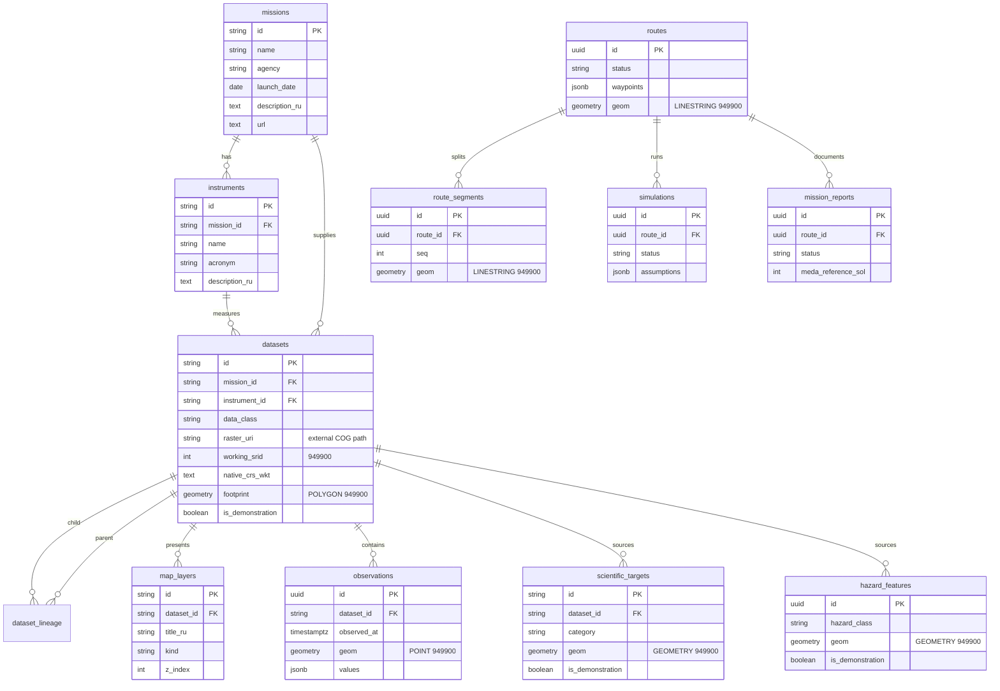

# MARSWALK — Database Design (Stage 4)

Version 2.0 · 2026-11-14 · PostGIS geospatial schema

Related: [`CRS_STRATEGY.md`](./CRS_STRATEGY.md) · [`SYSTEM_ARCHITECTURE.md`](./SYSTEM_ARCHITECTURE.md)

## 1. Storage split (critical)

| Store | Contents |
| --- | --- |
| **PostgreSQL + PostGIS** | Metadata, provenance, UTC timestamps, vector geometries (`POINT` / `LINESTRING` / `POLYGON`), foreign keys |
| **Filesystem COG/GeoTIFF** (`data/raw/`, `data/processed/`) | Raster pixels; referenced by `datasets.raster_uri` only |
| **Never** | `bytea` / `pg_raster` blobs of CTX/HiRISE mosaics |

Working CRS: **SRID 949900** (Mars 2000 planetocentric degrees). Metric queries use **SRID 949918** (Jezero equidistant cylindrical, meters). Earth `EPSG:4326` / `geography` are forbidden for distances.

## 2. ER diagram

## 3. Table explanations

| Table | Role |
| --- | --- |
| **missions** | NASA missions whose products MARSWALK uses (MGS, Odyssey, MRO, Mars 2020). |
| **instruments** | Instruments on those missions (MOLA, THEMIS, CTX, HiRISE, MEDA). |
| **datasets** | Product registry with full provenance + optional `raster_uri` to a COG on disk. `footprint` is a Mars polygon, not Earth WGS84. |
| **dataset_lineage** | Parent→child links for derived layers (slope from DTM, etc.). |
| **map_layers** | How a dataset appears on the map (WMTS / COG / vector), z-order, Russian title. `service` (JSONB) holds the connection: tile URL, native CRS as declared by the source, zoom range, attribution. |
| **observations** | Point time-series samples (future MEDA rows) with UTC `observed_at`. |
| **scientific_targets** | Geology / IAU / rover targets as points or polygons. |
| **hazard_features** | Vector hazard zones (demo until Stage 8 rule engine). |
| **routes** | Traverse LineString + JSON waypoints for API round-trip. |
| **route_segments** | Ordered segments with length/slope/hazard metrics. |
| **simulations** | EVA simulation requests tied to a route. |
| **mission_reports** | Report requests / snapshots tied to a route. |

## 4. Indexes

- B-tree on all foreign keys and common filters (`category`, `hazard_class`, `observed_at`).
- **GiST** on every geometry column: `datasets.footprint`, `observations.geom`, `scientific_targets.geom`, `hazard_features.geom`, `routes.geom`, `route_segments.geom`. One index per column, named `ix_*`; GeoAlchemy2's automatic `idx_*` is disabled (`spatial_index=False`).
- Unique (`route_id`, `seq`) on `route_segments`; unique lineage pairs.

## 5. Demonstration seed

Rows with `is_demonstration = true` and titles/labels containing **`DEMONSTRATION DATA`** are synthetic Jezero vectors for PostGIS verification only. They are **not** NASA observations.

## 6. Migration

- `0001` — Stage 3 interim schema.
- `0002` — enables PostGIS, registers Mars SRIDs `949900` / `949918`, rebuilds tables, seeds catalogue + demonstration spatial features.
- `0003` — data status becomes `REAL` / `DERIVED` / `SIMULATED` (Stage 5.5), adds `map_layers.service`, drops the duplicate `idx_*` GiST indexes that `0002` created next to `ix_*`.

## 7. Data status (`datasets.data_class`)

| Status | Meaning | Example |
| --- | --- | --- |
| `REAL` | Real scientific data from NASA / USGS services and archives | MOLA elevation, Trek mosaics, MEDA records |
| `DERIVED` | Computed by MARSWALK from `REAL` data; linked to parents in `dataset_lineage` | Slope raster from a DEM |
| `SIMULATED` | Demonstration or artificially created data | Stage 4 demo vectors, an unvalidated forecast |

`data_class` describes what the data is; `integration_status` says whether MARSWALK has actually connected it. A `REAL` product can still be `not_integrated`.
