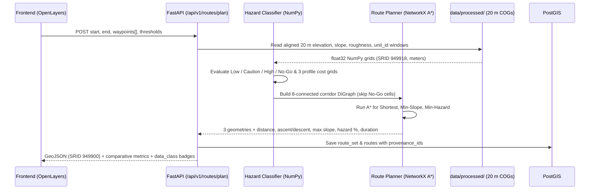
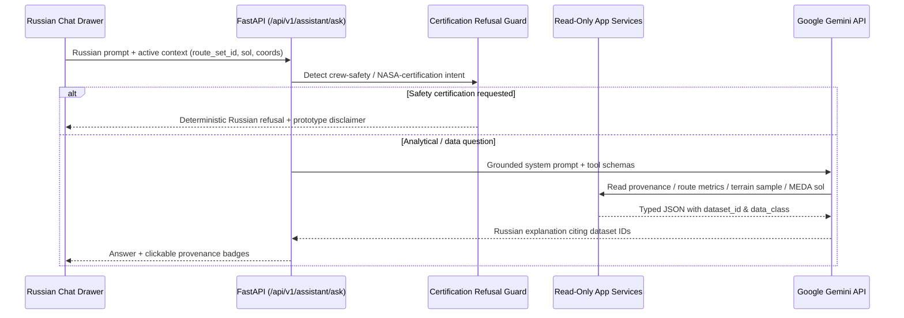

# MARSWALK — Data Flow & External Integration

Version 1.0 · Stage 1 deliverable

## 1. Core Data-Handling Rules

1. **Offline-first scientific archives:** NASA PDS and USGS Astrogeology repositories are queried by deterministic CLI ingestion scripts (`scripts/`) in Stage 5 — never directly by user HTTP requests at runtime.
2. **Immutable raw files + checksums:** Every downloaded product is stored untouched in `data/raw/` with its SHA-256 digest and original metadata/label (`data/metadata/`) before any clipping or reprojection into `data/processed/`.
3. **Explicit data class propagation:** Every pipeline step tags outputs as `REAL`, `DERIVED` or `SIMULATED` and links child records to parent `dataset_id` entries.

---

## 2. Stage 5 NASA Ingestion Workflow

```mermaid
sequenceDiagram
  participant CLI as scripts/ingest_*
  participant NASA as NASA PDS / USGS Archive
  participant RAW as data/raw/ + data/metadata/
  participant GDAL as GDAL / Rasterio / Parser
  participant PROC as data/processed/ (COGs)
  participant DB as PostgreSQL + PostGIS

  CLI->>NASA: Resumable HTTPS download
  NASA-->>RAW: Store untouched GeoTIFF / PDS4 XML+CSV / Shapefile / JSON
  CLI->>RAW: Verify SHA-256; extract native CRS WKT, resolution, observation dates
  CLI->>GDAL: Clip to Jezero bbox; create COG (SRID 949900) & metric grid (SRID 949918)
  GDAL-->>PROC: Save elevation, ortho, slope, aspect, hillshade, roughness COGs
  CLI->>DB: Register dataset + lineage + layer specs + vectors + MEDA sol rows
```

### Dataset-specific pipelines

| Dataset | Source | Pipeline Steps |
| --- | --- | --- |
| **MOLA Shaded Relief & THEMIS Day/Night IR** | NASA Mars Trek WMTS | Capabilities registered in `datasets`/`layers`; tiles fetched on demand through backend read-through disk cache (`data/processed/wmts_cache/`). |
| **M20 TRN CTX DTM (20 m) & Ortho (6 m)** | USGS Astrogeology (NASA MRO) | Raw GeoTIFF → SHA-256 → align metric 20 m grid (`SRID 949918`) → derive Horn slope, aspect, hillshade, roughness (`DERIVED`) → build display COGs. |
| **M20 TRN HiRISE DTM (1 m) & Ortho (0.25 m)** | USGS Astrogeology (NASA MRO) | Raw GeoTIFF → tiled COG with overviews → aggregate 1 m local elevation std-dev onto overlapping 20 m roughness cells (`DERIVED`). |
| **USGS SIM 3464 Jezero Geologic Map** | USGS Publications (MRO-derived) | Native shapefile/GDB → preserve native WKT → reproject polygons to `SRID 949900` in `geologic_units` + rasterize unit codes onto 20 m grid. |
| **Perseverance MEDA PDS4** | NASA PDS Atmospheres Node | Parse PDS4 `.xml` label + `.csv` calibrated rows → store sol metadata and time-series in PostGIS (`null` preserved for missing wind/sensor intervals). |
| **Perseverance Traverse & IAU Names** | NASA M20 feed & USGS Gazetteer | Checksummed snapshot in `data/raw/` → load points/lines into PostGIS `science_targets` (`SRID 949900`). |

---

## 3. Runtime Hazard & Route Calculation Flow



---

## 4. Grounded AI Assistant Flow


