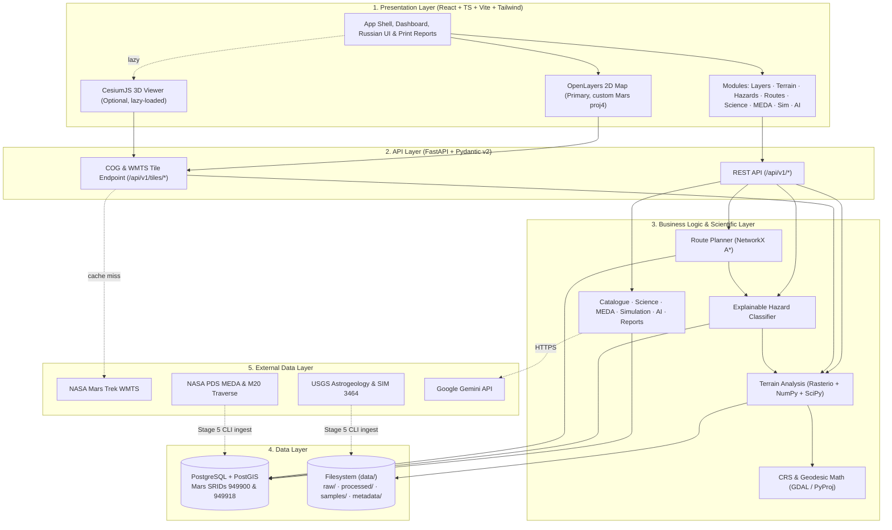

# MARSWALK — System Architecture

Version 1.0 · Stage 1 deliverable

Related architecture specs:
- [`DATA_FLOW.md`](./DATA_FLOW.md) — NASA ingestion, routing, and grounded AI data flows
- [`API_DESIGN.md`](./API_DESIGN.md) — REST endpoints, validation rules, error envelope, caching, logging
- [`DATABASE_DESIGN.md`](./DATABASE_DESIGN.md) — PostgreSQL + PostGIS schema, COG filesystem storage, lineage
- [`CRS_STRATEGY.md`](./CRS_STRATEGY.md) — Planetary coordinate systems (`SRID 949900`, `SRID 949918`), geodesic math

---

## 1. Architectural Pattern: Modular Five-Layer Monolith

MARSWALK uses a **modular five-layer monolith** orchestrated via **Docker Compose** (`db`, `backend`, `frontend`, plus bind-mounted `data/` storage on the local 500 GB drive).

Splitting terrain analysis, hazard classification, and routing into separate network microservices for a single-user scientific workstation would serialize multi-megabyte NumPy elevation arrays over HTTP for zero operational benefit. Isolating responsibilities into strict Python/TypeScript packages behind FastAPI routers preserves clean boundaries without message-broker or distributed-system overhead.

### Five layers

1. **Presentation Layer (`frontend/`)** — Russian-language SPA in React + TypeScript + Vite + Tailwind CSS styled with `DESIGN.md` tokens (`#ffffff`, `#2b2f36`, `#ed2023`, `7.2px` action corners, Cyrillic `Yeseva One` / `Pangolin`). **OpenLayers** is the primary 2D planetary GIS canvas (`proj4` custom Mars CRS); **CesiumJS** loads lazily on demand for 3D relief visualization.
2. **API Layer (`backend/app/api/`)** — FastAPI routers with Pydantic v2 validation, Mars coordinate bounds checks, provenance attachment, unified error envelopes, and tile serving.
3. **Business Logic & Scientific Layer (`backend/app/services/`, `backend/app/core/`)** — Pure Python/C geospatial algorithms (GDAL, Rasterio, NumPy, SciPy, NetworkX) separated from HTTP and ORM concerns.
4. **Data Layer (`PostgreSQL + PostGIS` & `data/`)** — PostGIS stores dataset metadata, recursive provenance lineage, geologic/target vectors, MEDA sol measurements, routes, and simulations; `data/` stores immutable raw NASA files and Cloud-Optimized GeoTIFFs (COGs).
5. **External Data Layer (`backend/app/integrations/`, `scripts/`)** — Offline-first batch ingestion from NASA PDS / USGS Astrogeology, read-through disk tile cache for NASA Mars Trek WMTS, and server-side Google Gemini tool-calling client.

---

## 2. System Component Diagram

---

## 3. Backend & Frontend Module Structure

### Backend (`backend/app/`)
- `api/` — FastAPI route handlers (`health`, `layers`, `tiles`, `terrain`, `hazards`, `routes`, `science`, `environment`, `simulations`, `assistant`, `reports`).
- `core/` — Settings (`.env`), structured logging, unified exception handlers, Mars CRS definitions, and pure scientific kernels (`dem_ops`, `hazard_rules`, `routing_graph`, `eva_sim`).
- `models/` — SQLAlchemy 2 + GeoAlchemy2 ORM entities.
- `schemas/` — Pydantic v2 request/response contracts, `DataClass` enum (`REAL`, `DERIVED`, `SIMULATED`), and provenance wrappers.
- `repositories/` — Encapsulated PostGIS & SQL queries.
- `services/` — Use-case orchestration combining repositories, COG rasters, and scientific kernels.
- `integrations/` — Mars Trek WMTS disk-cached proxy and Google Gemini read-only tool client.

### Frontend (`frontend/src/`)
- `app/` — Root shell, routing, persistent Russian non-certification disclaimer banner.
- `components/` — Shared `DESIGN.md` buttons, ruled cards, `DataClassBadge`, provenance modal, SVG halftone/star accents.
- `features/` — Domain modules (`map`, `layers`, `terrain`, `hazards`, `routes`, `science`, `environment`, `simulation`, `assistant`).
- `pages/` — `DashboardPage`, `ExplorerPage`, `MissionReportPage`.
- `hooks/`, `services/`, `types/`, `styles/` — Typed API client, map synchronization hooks, shared TypeScript interfaces, Tailwind + `DESIGN.md` tokens.

---

## 4. Technology Justification & Stage Dependency Order

| Component | Choice | Justification |
| --- | --- | --- |
| **2D GIS** | OpenLayers + `proj4` | Supports custom planetary projections (`IAU_2015:49900`) and non-Earth tile grids without forcing Web Mercator (`EPSG:3857`). |
| **3D GIS** | CesiumJS (lazy) | Supports custom `Ellipsoid(3396190, 3396190, 3396190)` and 3D heightmaps while keeping initial 2D load fast. |
| **Backend** | Python + FastAPI + Pydantic + SQLAlchemy + Alembic | Direct integration with GDAL/Rasterio/NumPy/SciPy/NetworkX plus typed REST boundaries and reproducible schema migrations. |
| **Database** | PostgreSQL + PostGIS | Custom Mars SRIDs in `spatial_ref_sys`, spatial `GIST` indexing for geology/targets, and relational provenance constraints. |
| **Testing** | Pytest + Playwright | Verifies numerical planetary math (`pytest`) and full Russian end-to-end user flows (`Playwright`). |

**Build sequence:** Stage 2 (Environment) → Stage 3 (Backend API core) → Stage 4 (PostGIS & Mars SRIDs) → Stage 5 (NASA Data Ingest) → Stage 6 (2D/3D Map) → Stage 7 (Layers & Terrain) → Stage 8 (Hazard Analysis) → Stage 9 (Route Planner) → Stages 10–11 (Science & MEDA) → Stages 12–13 (AI Assistant & Simulation) → Stage 14 (Reports & E2E verification).
